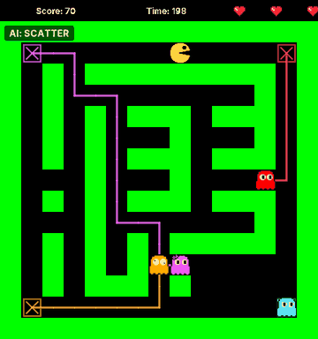

# Java Pac-Man

A Pac-Man clone written in Java Swing, with ghosts driven by A* pathfinding and individual chase strategies inspired by the original arcade game.



*Debug view (`D`): each line is a ghost's planned route, the crossed square is its current target.*

## Features

- 5 maze layouts, score, timer, lives and a high-score table
- Power-ups: apple, cherry, orange, key, slowdown
- **Ghost AI**
  - **A\* pathfinding:** ghosts always take the shortest route around walls
  - **Four personalities:**
    | Ghost | Strategy |
    |---|---|
    | 🔴 Blinky | Chases Pac-Man's current tile |
    | 🩷 Pinky | Aims 4 tiles ahead of Pac-Man to ambush him |
    | 🩵 Inky | Doubles the vector from Blinky to 2 tiles ahead of Pac-Man, flanking from the other side |
    | 🟠 Clyde | Chases when far away, retreats to his corner when close |
  - **Modes:** ghosts alternate between *Scatter* (go to their corners) and *Chase* on a timer; after a cherry they become *Frightened*, run away and can be eaten (200 → 400 → 800 → 1600 points)
  - **Debug overlay:** press `D` to see every ghost's route, target and the current mode

## Controls

| Key | Action |
|---|---|
| Arrow keys | Move |
| `D` | Toggle ghost AI debug view |
| `Esc` | Pause |

## Power-ups

| Item | Effect |
|---|---|
| 🍎 Apple | Coins are worth double for 5 s |
| 🍒 Cherry | +10 s on the timer, ghosts become frightened for 7 s |
| 🍊 Orange | Pac-Man moves twice as fast for 5 s |
| 🔑 Key | Extra life |
| 🐌 Slowdown | Ghosts move at half speed for 5 s |

## Project structure

```
src/pacman/
├── MainApp.java              # entry point
├── ai/                       # ghost AI
│   ├── Pathfinder.java       # A* search on the maze grid
│   ├── GhostPersonality.java # chase strategy of each ghost
│   ├── ModeController.java   # scatter / chase / frightened timing
│   ├── GhostMode.java
│   └── Tile.java
└── containers/               # Swing UI, maze, hero, ghosts, boosters
```

## Running

Requires JDK 20+.

**IntelliJ IDEA:** open the folder and run `pacman.MainApp`.

**Command line** (from the project root, so the `Images/` folder is found):

```bash
javac -d out $(find src -name "*.java")
java -cp out pacman.MainApp
```
